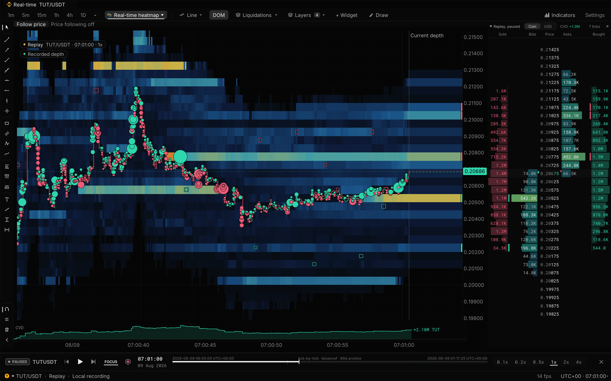
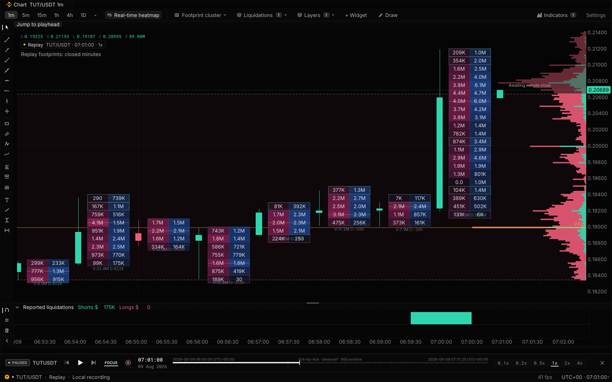
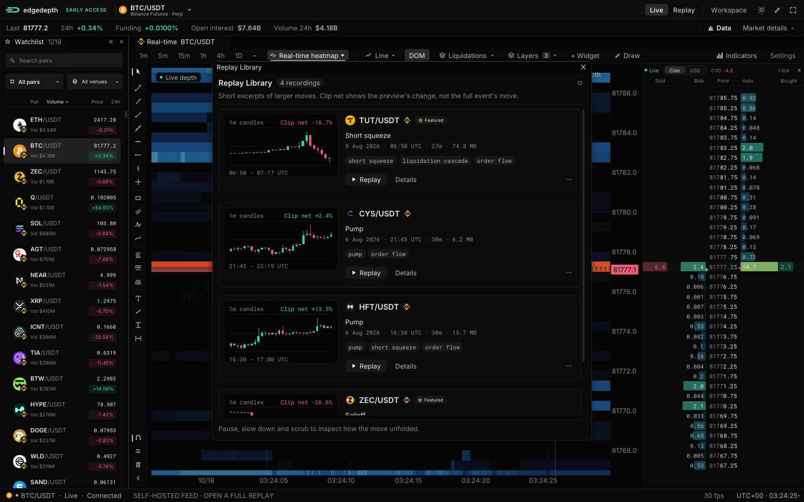

# EdgeDepth Terminal

[](https://github.com/edgedepthhq/edgedepth-terminal/actions/workflows/build.yml)
[](LICENSE)

**Open-source crypto order flow in your browser.**

See resting orders, watch trades as they happen, and replay recorded markets.
The C++/WebAssembly terminal behind [EdgeDepth](https://edgedepth.com/open-source?utm_source=github&utm_medium=oss&utm_campaign=terminal), ready to run with a local feed or your own data.

[](assets/oss-realtime-20261018.png)

*Actual OSS terminal, captured 18 October 2026. Public TUT/USDT recording from 9 August 2026, paused at 07:01 UTC and replayed locally without an account. Trade bubbles are enabled for this view; they start off in a fresh workspace. [Capture details](assets/README.md).*

## Run it locally

Install **Git** and **Docker with Compose** (Docker Desktop on Windows/macOS), then:

```bash
git clone https://github.com/edgedepthhq/edgedepth-terminal.git
cd edgedepth-terminal
docker compose up
```

Open **[localhost:8080](http://localhost:8080)**. This starts the terminal and the
[community gateway](https://github.com/edgedepthhq/edgedepth-gateway) on Binance's public data. No account or API key required.

The Docker Compose setup has been tested on **Linux and Windows**.

- **Live:** a fresh workspace opens in **Real-time depth**. Trade bubbles start off; enable them in **Layers** when wanted. Saved workspaces keep your choices.
- **Replay:** choose **Replay → Replay Library** and pick a free recording. It plays locally, without a live feed.

The gateway connects from your machine to Binance's public futures endpoints, and
Binance may be unavailable in some regions. If the live view stays empty, use the Replay
Library (its recordings come from `replays.edgedepth.com`, not Binance) or the no-install
replay below.

Use Chrome or Firefox; Safari is unverified. [Setup, troubleshooting and source builds](docs/SETUP.md).
Prefer no installation? [Play the same TUT recording in your browser](https://app.edgedepth.com/demo/20260809_071325_tutusdt_pump_4h_4h_371pct?utm_source=github&utm_medium=oss&utm_campaign=terminal):
a recorded replay served by EdgeDepth, no account needed.

## What's included

- **Order-book heatmap, DOM and time & sales:** watch resting liquidity and executed trades, with adjustable heatmap contrast and price grouping.
- **Bid/ask liquidity withdrawals:** see pulled liquidity and resting liquidity walls.
- **Trade bubbles and charts:** optional bubbles, candles down to 1 second, indicators, drawing tools and VWAP.
- **Reported liquidations:** view long and short liquidations as Binance publishes them. The feed does not report every liquidation that occurs.
- **Footprints and delta:** buy/sell volume at each price, volume delta, imbalances and cumulative volume delta (CVD).
- **Volume profile / VPVR:** point of control (POC) and value-area high/low (VAH/VAL).
- **TPO / Market Profile:** currently approximated from candle ranges in 30-minute blocks, rather than tick-by-tick price occupancy.
- **Replay Library:** open a free recording, play, pause, change speed and scrub through it in the same workspace.
- **Your workspace:** dock panels, save layouts and connect your own feed.

[](assets/oss-footprint-20261018.png)

*The same TUT recording and playhead, viewed as one-minute footprints with VPVR and reported liquidations. Footprints use closed minutes with recorded volume at each price; the forming minute is awaiting its close, and older context candles may have no footprint data.*

## Try a recorded move

1. Open **Replay → Replay Library** and choose a recording, such as the TUT/USDT short squeeze.
2. Play, pause, adjust the speed or scrub to a moment you want to inspect.
3. Compare the depth heatmap and trades with the footprint and volume profile.

The library downloads public `.edpack` recordings and plays them locally. It needs
internet access to fetch a pack, but no account, subscription or live exchange feed.
You can also [load your own recordings](docs/EDPACK.md).

[](assets/oss-replay-library-20261018.png)

*Replay Library in the actual OSS terminal, captured 18 October 2026. The live BTC view is visible behind the library.*

## Local and hosted access

**The terminal and community gateway are free to run locally.** You run the feed:
depth history starts with what you observe, replay packs contain only their recorded
markets and streams, and server-derived panels such as VPIN stay empty
([coverage details](docs/DATA_SOURCES.md)). This is a crypto analysis and replay
terminal; it does not provide live order execution or a bundled CME/broker feed.

[Hosted EdgeDepth](https://edgedepth.com/open-source?utm_source=github&utm_medium=oss&utm_campaign=terminal)
also has free live charts, footprints, TPO, order book and tape across its supported
Binance, Hyperliquid and Bybit markets. Binance BTCUSDT live depth is free all day;
other markets share a short daily depth preview. Recent BTC replay and recent
archived-event replays have free access with limits. Broader recorded-market replay
history, all-day depth on other markets and live reported liquidations require a
subscription. None of that is required for the local terminal or its Replay Library.
See [current hosted access and coverage](https://edgedepth.com/pricing?utm_source=github&utm_medium=oss&utm_campaign=terminal).

## Build on it

C++20 · WebAssembly · Dear ImGui / ImPlot · SDL3 / WebGL2.

- [Build and pin versions](docs/SETUP.md) · [Architecture](ARCHITECTURE.md) · [Contributing](CONTRIBUTING.md)
- [Bring your own data](docs/DATA_SOURCES.md#bring-your-own-data) · [CSV/Parquet walkthrough](docs/DATAFRAME_WORKFLOW.md) · [Wire protocol](protos/messages.proto)
- [Real-time depth guide](docs/REALTIME_DEPTH.md) · [Replay pack format](docs/EDPACK.md) · [Replay Library](replay-library/README.md)
- [Design tokens](design/README.md) · [Research MCP](https://github.com/edgedepthhq/edgedepth-research-mcp)

[AGPL-3.0](LICENSE) terminal · [MIT gateway](https://github.com/edgedepthhq/edgedepth-gateway) · [Third-party licenses](THIRD_PARTY_NOTICES.md).
